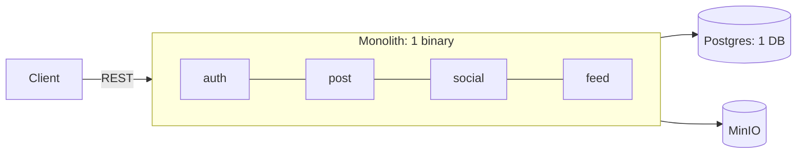
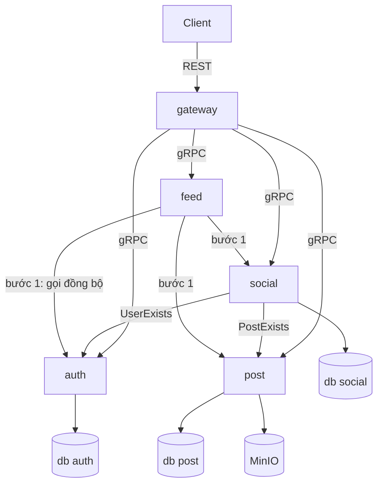
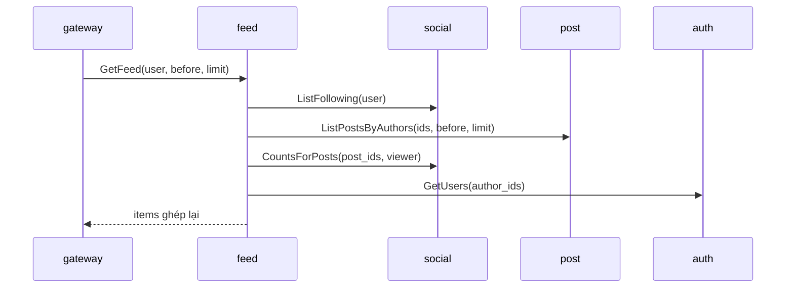
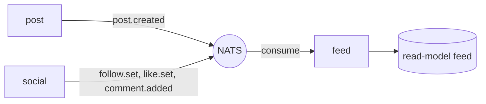

# Kiến trúc: Monolith vs Microservice

Tài liệu này mô tả kiến trúc của hai bản theo thiết kế đã duyệt; hai bản đã được cài đặt. Số liệu đo thật nằm ở [README](../README.md#kết-quả-so-sánh), các chỗ thiết kế đã đổi khi cài đặt được ghi tại chỗ. Sơ đồ tương tác: [architecture.html](architecture.html).

Cả hai bản dùng Go, cùng một REST API (`api/openapi.yaml`) và cùng một bộ test hợp đồng, để khác biệt chỉ nằm ở kiến trúc bên trong.

## 1. Monolith

Một binary Go, các package theo miền, một Postgres, ảnh ở MinIO.

- Các package gọi nhau bằng **hàm Go trực tiếp**.
- Feed là **một truy vấn `JOIN`** (posts × follows × users, đếm like/comment bằng subquery).
- Kiểm tra user/post tồn tại bằng khóa ngoại.
- Một process: chạy hoặc chết cùng nhau.

## 2. Microservice

Gateway nhận REST, verify JWT, gắn `x-user-id` vào gRPC metadata rồi gọi các service. Nội bộ chỉ dùng gRPC.

| Service | Sở hữu | Ghi chú |
|---|---|---|
| gateway | không có DB | REST → gRPC, verify JWT, map mã lỗi gRPC sang HTTP |
| auth | users, credentials | cấp JWT, `UserExists`, `GetUsers` (batch) |
| post | posts, ảnh trên MinIO | nhận ảnh bằng gRPC client-streaming, tối đa 5 MiB, trả URL presigned |
| social | follows, likes, comments | follow gọi `auth.UserExists`; like/comment gọi `post.PostExists` |
| feed | bước 1: không có DB; bước 2: read-model riêng | dựng feed |

Quy tắc: một Postgres container chứa 4 database, mỗi service có user Postgres riêng và chỉ truy cập DB của mình. Service không đọc bảng của service khác và không có khóa ngoại xuyên service.

Ánh xạ mã lỗi gRPC sang HTTP ở gateway: `NotFound`→404, `AlreadyExists`→409, `InvalidArgument`→400, `Unauthenticated`→401, `ResourceExhausted`→413, `Unavailable`→503.

## 3. Feed: hai cách trong cùng một bản microservice

Chọn bằng biến môi trường `FEED_MODE=sync|event`.

### Bước 1: gRPC đồng bộ (`sync`)

Dữ liệu luôn mới, nhưng feed cần cả bốn service. Một service chết thì `GET /feed` trả **503**.

### Bước 2: event qua NATS (`event`)

- `post` và `social` phát event sau mỗi lần ghi DB thành công. Lỗi publish chỉ được log, không làm hỏng request.
- `feed` nghe event và giữ bảng riêng: bài viết (kèm **tên tác giả** lấy sẵn từ `auth.GetUsers` khi tạo bài), danh sách follow, bộ đếm like/comment, và like theo từng user.
- `GET /feed` chỉ đọc bảng của `feed`, không gọi service nào khác. Feed vẫn trả được khi `social` hoặc `auth` chết, nhưng dữ liệu có thể cũ.
- Đánh đổi: **eventual consistency**. Like xong chưa chắc thấy ngay trong feed. Test hợp đồng cho phép poll tối đa khoảng 2 giây, và độ trễ này là một phần của điều cần quan sát.

Payload event:

| Subject | Payload |
|---|---|
| `post.created` | `post_id, author_id, author_name, caption, image_key, created_at_micro` |
| `follow.set` | `follower_id, followee_id, following` |
| `like.set` | `post_id, user_id, liked` |
| `comment.added` | `post_id, comment_id` |

Khác thiết kế ban đầu, có lý do: `post.created` mang `image_key` thay vì `image_url` vì URL ký sẵn hết hạn (read-model giữ URL cũ sẽ hỏng ảnh), nên `feed` ký URL lúc đọc; `created_at_micro` giữ đúng timestamp cho cursor; `comment.added` thêm `comment_id` để bỏ qua event giao trùng. Đây là NATS pub/sub thường: giao tối đa một lần, không phát lại, nên event phát lúc `feed` đang tắt sẽ mất. Read-model chỉ được dựng từ event nhận được lúc `FEED_MODE=event`, không có backfill: dữ liệu tạo trước đó, hay trong lúc chạy `sync` (cũng như lúc feed tắt), không bao giờ xuất hiện hoặc không được sửa lại. Khi đổi chế độ, xoá database `feed` (`docker compose down -v`) rồi chạy lại. Event còn nằm trong bộ đệm của producer lúc service thoát (SIGTERM, `log.Fatal`) cũng mất. Với cùng một cạnh follow/like, producer ghi rồi phát dưới một khoá nên thứ tự phát khớp thứ tự commit; event của các service khác nhau thì không có thứ tự chung, nên consumer phải chịu được `like.set` đến trước `post.created`.

## 4. So sánh theo bốn điểm

| | Monolith | Microservice, `sync` | Microservice, `event` |
|---|---|---|---|
| **Data ownership** | 1 DB, feed là `JOIN`, FK bảo vệ tính toàn vẹn | mỗi service một DB, feed ghép bằng gRPC, không có FK xuyên service | thêm read-model riêng cho feed, dữ liệu được sao chép |
| **Giao tiếp** | gọi hàm | gRPC đồng bộ | gRPC cho truy vấn, NATS cho event |
| **Một phần chết** | cả app chết | tắt `social`: feed 503, follow/like/comment lỗi; login và đăng ảnh vẫn chạy | tắt `social`: feed vẫn 200 (dữ liệu cũ); follow/like/comment vẫn lỗi |
| **Chạy/deploy** | 1 app + Postgres + MinIO | gateway + 4 service + Postgres + MinIO + NATS | như `sync` (NATS chạy ở cả hai chế độ; ở `sync` event vẫn được phát nhưng feed không dùng) |

Các hàng "Một phần chết" đã được đo bằng `scripts/failure.sh`; kết quả ở README.

### Ai cần ai (microservice)

| Thao tác | `sync` cần | `event` cần |
|---|---|---|
| Đăng nhập | auth | auth |
| Đăng ảnh | post, auth (lấy tên tác giả) | post, auth (lấy tên tác giả) |
| Follow / Unfollow | social, auth | social, auth |
| Like / Unlike | social, post | social, post |
| Thêm / xem comment | social, post, auth (lấy tên tác giả) | social, post, auth (lấy tên tác giả) |
| Xem feed | feed, auth, post, social | feed |

## 5. Những thứ cố ý không làm

Production, scale thật, Kubernetes, service discovery, tracing, retry/circuit breaker phức tạp, GUI, xử lý ảnh, tìm kiếm, notification, refresh token. Chúng làm lệch mục tiêu so sánh.

## 6. Tài liệu liên quan

- Thiết kế: `docs/superpowers/specs/2026-11-21-photo-share-monolith-vs-microservice-design.md`
- Kế hoạch: `docs/superpowers/plans/2026-11-21-photo-share.md`
- Hợp đồng API: `api/openapi.yaml`
